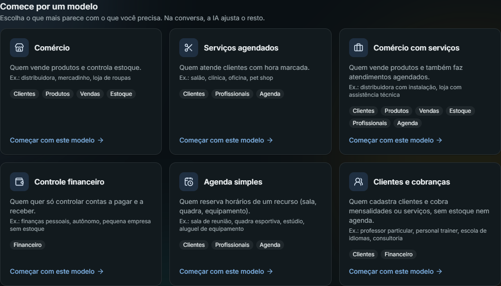
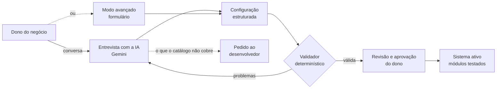
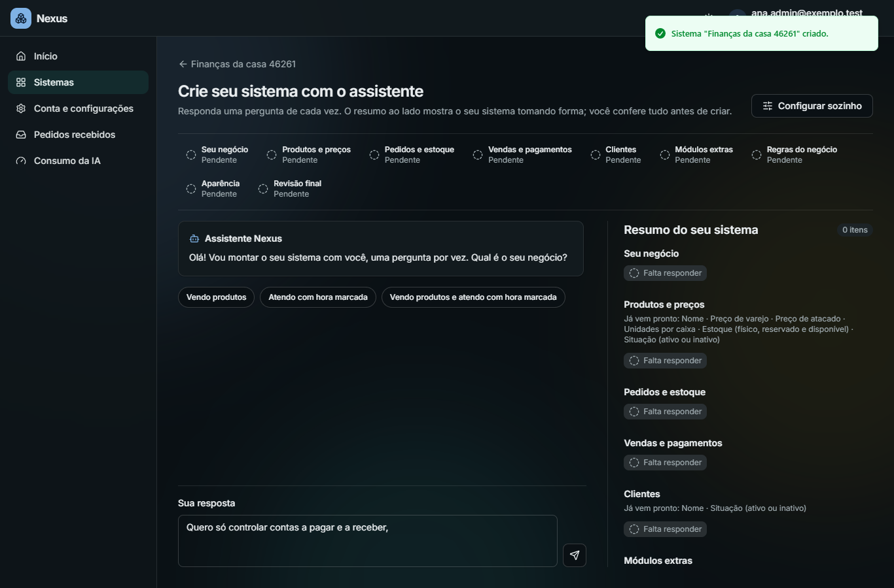
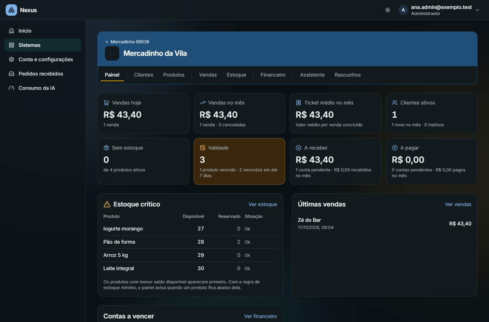
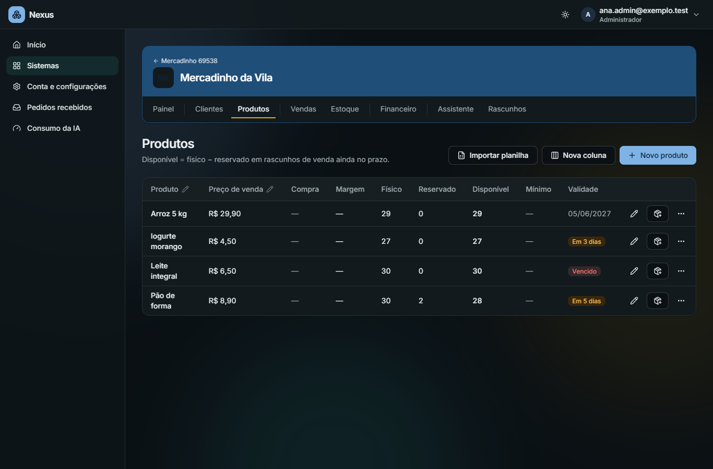

# Nexus

[](https://github.com/NathanThomaz/TCC/actions/workflows/ci.yml)

**Sistemas de gestão web para pequenos negócios, configurados numa conversa com IA e executados por módulos testados.**

Trabalho de Conclusão de Curso em Sistemas de Informação: _Nexus: construção de sistemas de gestão web para pequenos negócios com IA generativa e módulos reutilizáveis_.

> **Pergunta de pesquisa:** como combinar IA generativa, módulos reutilizáveis e validação determinística para transformar necessidades de pequenos negócios em sistemas de gestão web que atendam aos requisitos confirmados pelo usuário?



## A ideia

O dono de um pequeno negócio (uma distribuidora, um salão, um professor particular) raramente encontra um sistema pronto que siga as regras dele, e não tem como pagar um feito sob medida. No Nexus, ele **descreve o negócio numa conversa**. A IA pergunta uma coisa de cada vez, confirma cada regra e monta uma configuração. O sistema passa a funcionar dentro da própria plataforma, com as telas, os cadastros e as regras dele.

A IA **não gera código nem SQL**. Ela só preenche uma configuração estruturada, escolhendo entre módulos e regras de um catálogo que já foi implementado e testado. Um **validador determinístico** confere essa configuração antes de qualquer coisa ir ao ar, e as regras são executadas por código testado, que continua funcionando mesmo sem a IA.



## O que já funciona

O Nexus está **em produção**. A versão usada no experimento do trabalho está congelada na tag [`experimento-v8`](https://github.com/NathanThomaz/TCC/tree/experimento-v8).

### Seis modelos para começar

| Modelo                    | Para quem                                                  | Módulos                                                    |
| ------------------------- | ---------------------------------------------------------- | ---------------------------------------------------------- |
| **Comércio**              | Vende produtos e controla estoque                          | Clientes, Produtos, Vendas, Estoque                        |
| **Serviços agendados**    | Atende clientes com hora marcada                           | Clientes, Profissionais, Agenda                            |
| **Comércio com serviços** | Vende produtos e faz atendimentos agendados                | Clientes, Produtos, Vendas, Estoque, Profissionais, Agenda |
| **Controle financeiro**   | Só quer controlar contas a pagar e a receber               | Financeiro                                                 |
| **Agenda simples**        | Reserva horários de um recurso (sala, quadra, equipamento) | Clientes, Profissionais, Agenda                            |
| **Clientes e cobranças**  | Cadastra clientes e cobra mensalidades ou serviços         | Clientes, Financeiro                                       |

Os modelos de comércio aceitam ainda os módulos opcionais **Formas de pagamento**, **Fornecedores e compras** e **Financeiro**.

### Vinte regras de negócio para escolher e ajustar

| Área           | Regras                                                                                                                                                                     |
| -------------- | -------------------------------------------------------------------------------------------------------------------------------------------------------------------------- |
| **Vendas**     | Preço de atacado a partir de uma quantidade, venda por caixa, pedido mínimo, limite por item, prazo para cancelar, formas de pagamento, limite de crédito na venda a prazo |
| **Estoque**    | Reserva com prazo para vendas em rascunho, estoque mínimo, validade dos produtos com aviso, saída com motivo (perda, consumo, quebra)                                      |
| **Agenda**     | Atendimentos em par, horário de funcionamento, antecedência mínima, prazo para cancelar                                                                                    |
| **Financeiro** | Categorias de despesa e receita, aviso de vencimento, orçamento mensal por categoria, multa e juros por atraso                                                             |
| **Clientes**   | Aviso de cliente sem comprar há N dias                                                                                                                                     |

Cada regra é aplicada pela operação do sistema, inclusive no banco quando é uma garantia (por exemplo, o estoque nunca fica abaixo do que está reservado).

### No dia a dia do sistema criado

- **Painel** com indicadores calculados pelo servidor: vendas, ticket médio, estoque crítico, validade, contas a receber e a pagar, orçamento.
- **Vendas** com reserva de estoque no rascunho, leitor de código de barras (USB ou câmera) e venda ditada ou escrita, que a IA transforma num rascunho para conferir.
- **Rascunhos automáticos** em todos os cadastros, para continuar depois.
- **Assistente**: perguntas sobre os dados do sistema, só de leitura (a IA não altera nada).
- **Importação de planilha**, colunas com os nomes do negócio, logotipo e cores próprias.
- **Alterar o sistema ativo** sem perder dados, além de inativar, reativar e excluir sistemas.
- **Pedidos ao desenvolvedor**: o que o catálogo não cobre vira um pedido acompanhado pelo dono do Nexus.
- **Contas**: cadastro com e-mail confirmado, administradores independentes, contas secundárias por convite e limite de uso da IA por conta.

**Criação com o assistente:** uma pergunta por vez, com o resumo do sistema tomando forma ao lado.



**Painel de um mercadinho**, com o aviso de validade dos produtos:



**Produtos** com validade, estoque físico, reservado e disponível:



_Todas as telas usam dados fictícios._

## Arquitetura

| Camada       | Tecnologia                                                           |
| ------------ | -------------------------------------------------------------------- |
| Front-end    | React 19, TypeScript, Tailwind CSS 4, shadcn/ui, TanStack Query      |
| API          | TypeScript num único Cloudflare Worker, que também serve o front-end |
| Banco        | Cloudflare D1 (SQLite), com 17 migrations                            |
| Autenticação | Firebase Authentication, com o token verificado no Worker            |
| IA           | Google Gemini (`gemini-3.1-flash-lite`), com saída estruturada       |
| Contrato     | Zod, compartilhado entre front-end, API e IA                         |

Decisões que sustentam a proposta:

- **Um contrato só.** O catálogo de módulos e regras e o formato da configuração vivem em `src/shared/contract`. O mesmo esquema Zod valida o formulário, a API e a resposta do Gemini (o esquema enviado à IA é gerado a partir dele).
- **A IA propõe, o código decide.** O validador recusa dependências ausentes, regras repetidas ou contraditórias e valores fora do permitido, e devolve à conversa o que precisa ser resolvido.
- **Garantias no banco.** Invariantes como "estoque não fica abaixo do reservado" e "sistema inativo não recebe vendas" são triggers do D1. Escritas usam lotes atômicos e chaves de idempotência, então repetir uma requisição não duplica nada.
- **Números pelo servidor.** Painel e Assistente mostram valores calculados pelo backend no fuso de Brasília, nunca pela IA.

As decisões de arquitetura estão registradas em 15 ADRs no [Vault do autor](https://github.com/NathanThomaz/ObisdianDocument/tree/main/01%20-%20Projetos/TCC).

## Qualidade

- **491 testes** (Vitest). Os do Worker rodam no runtime real do Workers (`workerd`), com D1 local e todas as migrations aplicadas.
- **CI** em todo PR: formatação, lint, tipos, integridade dos cenários do experimento, testes e build. A `main` é protegida e só recebe PR com CI verde.
- **Revisão cruzada**: cada mudança passa pela revisão de outro agente de IA (Codex) antes do merge.
- **Provas técnicas** com resultado registrado, em [`provas/`](provas):
  - [atomicidade e concorrência no D1](provas/d1-atomicidade/README.md);
  - [saída estruturada do Gemini com esquema gerado do Zod](provas/gemini-schema/README.md);
  - [entrevista guiada com o Gemini real](provas/gemini-entrevista/README.md);
  - [convite, e-mail confirmado e revogação no Firebase](provas/firebase-convite/README.md).

## Avaliação

O experimento compara a configuração **pela conversa com a IA** com a configuração **pelo formulário**, em três cenários fictícios (loja de materiais, pet shop e oficina de bicicletas). A métrica principal é a aderência da configuração final a um gabarito; o tempo é secundária. Os cenários estão em [`experiments/cenarios`](experiments/cenarios/README.md) e foram congelados com SHA-256 conferido pelo CI.

## Desenvolvimento

Requer **Node 24.12 ou superior** (que já traz o npm 11; o npm 10 falha ao resolver as dependências do Vitest 5).

| Para                         | Comando                                                                              |
| ---------------------------- | ------------------------------------------------------------------------------------ |
| Instalar                     | `npm ci`                                                                             |
| Validar tudo (o mesmo do CI) | `npm run check`                                                                      |
| Rodar localmente             | `npm run dev`, depois de aplicar as migrations locais com `npm run db:migrate:local` |
| Testes em modo observação    | `npm run test:watch`                                                                 |

Segredos (conta de serviço do Firebase, chave do Gemini) não ficam no repositório: em produção são gravados no Worker com `wrangler secret`.

```text
src/
  shared/    contrato (catálogo, esquema, validador) e regras de domínio usadas pelo front e pela API
  worker/    API: autenticação, criação com IA, operação dos módulos, painel
  web/       front-end React
migrations/  esquema do D1, com triggers das garantias
test/        testes do Worker e do domínio
provas/      provas técnicas com resultado registrado
experiments/ cenários congelados do experimento
scripts/     backup do D1, teste de fumaça da produção, provisionamento
```

## Histórico do repositório

Este repositório abrigou as versões anteriores do trabalho (Forja e Nexo, em Python), removidas em 2026-11-03 para o recomeço com o Nexus. O estado final delas está na tag [`legado-forja-nexo`](https://github.com/NathanThomaz/TCC/tree/legado-forja-nexo).

## Autor

**Nathan Thomaz Quintanilha** — Sistemas de Informação, Unilasalle. Orientadora: Claudia Abreu.

Documentação técnica, decisões e histórico de sessões: [Vault do autor — TCC](https://github.com/NathanThomaz/ObisdianDocument/tree/main/01%20-%20Projetos/TCC).
